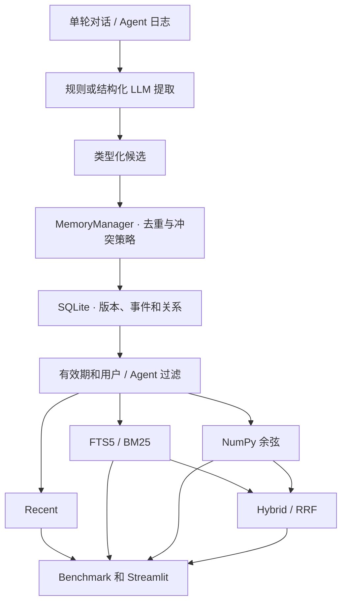

# 架构

## 写入和读取

MemoryManager 为每个用户和 Agent 创建作用域。事实槽位还包括 scope、记忆类型、标准化后的 entity 与 attribute。session_id 和 source_id 作为来源信息，可跨同一作用域的会话更新。标识、枚举、置信度和时间区间在写入前校验。

SQLite 保存 identity、revision、event 和 relation。版本以 (memory ID, version) 标识，事件及关系引用具体版本。版本载荷写入后保留，单独的 visible 字段控制事实有效期投影。WAL 和 busy_timeout 支持本地读写，写路径使用 BEGIN IMMEDIATE，完成版本、FTS5 触发器、事件及关系后一起提交。界面编辑携带 expected_version，可拦截过期编辑。

## 生命周期与时间

- Append-only 保留重叠事实，记录未确认冲突。Versioned-update 仅在显式替代、唯一候选、槽位和有效时间满足条件时结束旧记录。已知 previous_value 时还需匹配旧值。
- 自动替代为新证据分配新 ID，旧 ID 添加结束时间明确的 superseded 版本，写入 supersedes 关系。手动编辑继续沿用同一 ID。常规编辑关闭先前区间，然后创建新版本。
- 软删除写 tombstone，当前检索排除该条，既有历史保留。恢复选中旧版本的内容并从恢复时刻重新生效。归并写入新摘要，用 consolidates 关系链接来源。
- 事实时间和记录时间独立。用 [valid_from, valid_to) 过滤，缺失边界视为开放。as_of 默认当前；历史可返回状态为 superseded 的旧投影。记录时间用于审计和 Recent 排序。当前 API 不执行事务时间双时态回放。
- 对同一稳定 source_id、session_id 和内容的重放，可识别初始版本并返回当前头部，避免演示重复导入重新激活已经被替代的事实。

## 检索和评估

四种检索器共用 Retriever.search，支持 top_k、user_id、agent_id、memory_type、as_of 和 include_history。历史时间查询优先使用有效期投影。无历史时间且启用 include_history 时可浏览所有审计版本，可能返回同一 ID 的多个版本。数据库层使用参数绑定，FTS5 接收安全引用的分词项。

BM25 的候选以过滤结果为准，词频统计使用当前数据库的整个 FTS 索引，包含审计版本。该作用域隔离适用于本地实验，不能作为授权机制。Vector 按文本生成向量，标准化后做余弦检索，保留正分结果。Hybrid 在同一读取事务内用 RRF 融合两路排名，两路深度均为 max(20, top_k)。

Benchmark 把合成候选写入两个独立临时数据库，用相同查询和时点运行检索。gold IDs 和 stale 时间表只供检索后的打分使用。Streamlit 显示样例数据库内容以及保存的实测报告。

## 扩展点

MemoryExtractor 接收文本及已知生效时间。LocalLLMProvider.complete 返回受 JSON Schema 约束的文本。LocalEmbeddingProvider.embed 接收文本批次并返回二维 NumPy 数组。MemoryCompressionProvider.compress 接收记忆记录及来源，可由显式配置加载后续本地模型。
